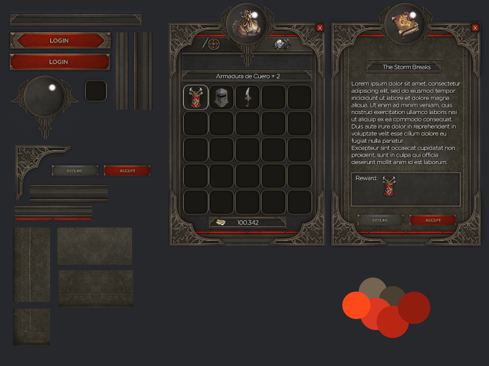

# RPG Game UI — Wyrmheart

ArcQ 的 `WYRMHEART` 全局 HUD 风格使用的原始美术资源。

- 作者：Wyrmheart
- 来源：https://opengameart.org/content/rpg-game-ui
- 下载日期：2026-10-26
- 授权：CC0 1.0 Universal；可免费用于个人与商业项目，无需署名。
- 授权说明：https://creativecommons.org/publicdomain/zero/1.0/

## 文件

| 文件 | 内容 |
| --- | --- |
| `interface.psd` | 原始 Photoshop 文件，800×600，4,418,537 字节 |
| `muestra-final.png` | 作者发布的预览图，800×600 |
| `CC0-1.0.txt` | Creative Commons 发布的 CC0 1.0 授权全文 |
| `source.json` | 来源 URL、文件大小、下载日期与 SHA-256 校验值 |

PSD 与预览图保留下载时的原始字节，未做裁剪、改色或重新保存。此目录用于保存美术源文件，位于游戏运行资源目录之外。`tools/extract_wyrmheart.py` 提取边框、按钮和徽章元素，生成 `src/main/resources/assets/arc_quest/textures/gui/style/wyrmheart.png`；修改仅作用于派生图集。模组运行时由 `WyrmheartUiRenderer` 接入主题色、品质色与原有透明度。

